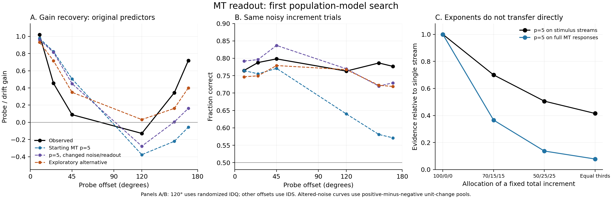

# MT readout: first exploration batch — 25 October 2026

The export is sufficient for local exploration. No joint solution was found in this first bounded search. The starting p=5 population model misses the far-offset rebound and predicts an excessive cost of divided signal allocation. Several modifications improve individual features, but no confirmed setting satisfies the whole pattern.

## Data and validation

All 190 exported sources passed numerical validation, including reconstruction of both 250-ms windows, trial identity, 2AFC side/outcome consistency, direction reordering, IDR yoking, and top-up exclusion. There are 147,265 valid trials and 82,143 noisy increment trials. All sources are Meetz.

```csv
domain,n_files,n_trials,n_fit_trials
IDS,20,24413,15914
IDQ,10,11860,7124
IDJ,5,6942,6942
IDR,155,104050,52163
```

Random-base-direction IDQ supplies 7,124 noisy increment trials at 120 degrees. The fixed-base IDQ sources were deliberately excluded. One IDR source, `IDReadout_Meetz_20260305_Probe45.mat`, failed export because its noise/time event counts differ; this does not block the current analysis. No exported window has materially negative physical coherence or exceeds the 100% coherence budget.

The experimental gain fits were reproduced from the saved predictors and Weibull calibration, to approximately 0.000002 in the gain coefficients. Native IDS uses its original change-RDK drift and pooled probe predictors. Random IDQ uses the saved four-predictor model (change/no-change RDK × drift/probe), retaining the distinction between RDK roles. No new behavioral confidence intervals or significance tests were computed.

The native IDS 120-degree estimate has only one source/session and a very broad interval. It is retained as a diagnostic but is not a search target. The randomized IDQ summary is the principal target at 120 degrees. The uploaded native IDS data have 10 and 170 degrees as the nearest sampled endpoints; these are not measurements at exactly 0 and 180 degrees.

## Starting model

For unit i, the mean response is the Gaussian-tuned response to every coherent stream plus the response to the remaining isotropic dots:

`R_i = (100 - sum(c)) * mean(G) + sum_k c_k * G_i(direction_k)`.

Gaussian sigma is initially 37.5 degrees, with a dense circular bank. Independent internal Gaussian fields are added in each RDK and each time window, with correlation over preferred direction. Absolute firing rates are floored at zero. The starting evidence for each RDK is `norm_p(R_step) - norm_p(R_pre)`, retaining its sign. The decision selects the RDK with larger evidence. Both windows last 250 ms: 500–750 and 750–1000 ms.

The confirmed starting p=5 run uses the earlier IDS-calibrated noise SD 5.29842, a 30-degree correlation length, and zero spontaneous offset. This is a reference replication, not a newly optimized fit to all four tasks.

## What was searched

The initial grids evaluated **2,006 settings** against the IDS/random-IDQ gains and accuracy. Every exponent was uniform over direction, RDK, and window within a model. No angle-specific exponents or temporally correlated noise between the two windows were introduced. Nothing below p=2 was needed for this batch.

- 900 settings: p=2,3,5,8,infinity; tuning sigma=25,37.5,50 degrees; directional correlation lengths=15,30,60 degrees; internal SD=2.5,5,10,20. Readouts were pooled signed changes, rectified unit changes, positive-minus-negative change pools, half-strength unit reference subtraction, and a post-only control.
- 864 settings: internal SD=1,2.5,5,10; p=3,5,infinity; sigma=25 or 37.5. Compared ordinary smooth fields, fields with their uniform mode removed, and fields mixing smooth fluctuations with a first-harmonic opponent component. Noise SD was constant, proportional to sqrt(response), or proportional to response. Also tested squaring the pooled response before pre/post subtraction.
- 192 settings: a direction-specific noisy prestep response supplied divisive adaptation, at strengths 0.3,1,3,10; pooled-change and rectified-unit-change variants.
- 50 settings: directional pooling in each exported 50-ms bin followed by temporal averaging, versus averaging MT responses before directional pooling. This is an approximation to online processing; activity within a 50-ms bin is not retained in this export. Internal noise was a window-estimation field held across bins within its window, independent between windows.

Search scores combined deviations in probe/drift gain ratios and accuracy, using fixed navigation scales 0.15 and 0.05 respectively. They are optimization aids, not statistical evidence. Native IDS120 did not contribute to the score.

Coarse runs used up to 180 randomly selected trials per gain group, a 5-degree bank, 32 antithetic draws per patch/window, and all cross-patch draw pairs for 2AFC probabilities. Selected settings were then evaluated on **all 23,038 noisy IDS/IDQ trials**, using a 2-degree bank and 128 draws, with independent Monte Carlo noise. Four initial finalists also received an independent-seed 1-degree/256-draw check on 1,152 trials. Mean probability differences were below 0.002; single-trial RMS differences 0.016–0.024 reflect grid and Monte Carlo changes together. The two later noise finalists were checked separately in `noise_resolution_check.json`.

## Gain results

All values below are pooled probe gain divided by drift gain, recovered with the original experimental predictors and calibration.

| Condition | Observed | Starting MT p=5 | Exploratory alternative |
|---|---:|---:|---:|
| IDS_10 | 1.02 | 0.98 | 0.93 |
| IDS_25 | 0.45 | 0.82 | 0.72 |
| IDS_45 | 0.09 | 0.50 | 0.35 |
| IDQ_120 | -0.13 | -0.38 | 0.03 |
| IDS_155 | 0.35 | -0.22 | 0.16 |
| IDS_170 | 0.72 | -0.06 | 0.40 |

The alternative uses sigma 25 degrees, hard maximum, positive-minus-negative unit-change pools, response-proportional noise SD, and a latent directional field with its uniform mode removed. Its partial far-offset recovery is informative, but its 25/45-degree gains are too large, its 120-degree gain is not negative, and its far-offset accuracy remains too low. It also explicitly uses negative unit changes, departing from the preferred increase-only physiological interpretation. It is a diagnostic candidate, not an accepted explanation.

Keeping p=5 and sigma 37.5 in that noise/readout family yields approximately 0.16 at 170 degrees and −0.28 at 120, still far from the combination required. The all-trial rectified-unit-change finalist also fails the far-offset rebound. Changing subtraction/rectification order alone was insufficient in this grid. The tested divisive templates and temporal-pooling order did not solve the joint problem.

Allowing a separate overall Weibull sensitivity scale when recovering each model's gains changes their magnitudes somewhat but does not remove these pattern failures. These checks are saved with the confirmed results under `own_scale`.



## Why population p=5 is not stimulus-stream p=5

With sigma 37.5, three streams separated by 120 degrees, a 7.071% pedestal in each stream, and a 15-percentage-point total increment, the noiseless signed population-norm difference for equal thirds is **0.078** of that for a single-stream increment. Applying p=5 directly to the three increments gives **0.415** instead. Rectifying unit changes first gives approximately 0.115 in this example.

These are evidence ratios for an illustrative stimulus, not fitted behavioral exponents or predicted accuracy ratios. The full MT response includes coherent-dot replacement of isotropic dots. This replacement introduces a broad negative response component, while the equal pre-step pedestals affect the population norm. Consequently, a p inferred between a few stimulus streams cannot simply be inserted as the exponent over full MT firing rates and expected to preserve its behavioral meaning.

## IDJ and IDR checks

IDJ noise SD was calibrated by choice likelihood on the single-stream allocation trials only, then transferred unchanged to divided-allocation trials. The exponent and other parameters were fixed within each check. A shared SD across sessions is a deliberately restricted calibration; it does not guarantee matching reference accuracy.

| Largest allocation fraction | Trials | Observed accuracy | Starting family, p=5 |
|---|---:|---:|---:|
| 1.000 | 1739 | 0.763 | 0.701 |
| 0.700 | 1736 | 0.736 | 0.642 |
| 0.500 | 1728 | 0.701 | 0.573 |
| 0.333 | 1739 | 0.711 | 0.544 |

This starting family has too much allocation cost, and even its reference accuracy is low. The alternative noise/readout family reduces the allocation penalty; `idj_alternative.json` records its transfer, including remaining reference mismatch. No joint IDS/IDQ/IDJ fit is claimed.

For IDR, eight starting-family and four alternative-family transfer checks used actual stimulus windows and yoking. Lowering p alone did not supply the desired broadly elevated off-axis influence. **These IDR gain ratios are exploratory probit regressions on uniform step-window change-RDK noise, with nominal-step intercepts.** The export does not include the historical IDR gain-analysis function/summary, so they must not be presented as exact replications of the published/current kernel-weighted IDR gains. Separate results at 179 and 180 preserve the different physical stream construction. These checks used at most 800 trials per offset, not all 104,050 IDR trials.

## Interpretation and next priorities

The completed batch provides a bounded negative result for the simple starting implementation, with two constructive findings: the mapping from population p to behavioral p depends strongly on reference/signal representation, and response-dependent directional noise can change the far-offset rebound substantially. Neither finding establishes a biologically acceptable joint account yet.

Further work should compare explicit prestep-template/reference mechanisms and response-dependent directional covariance while keeping the full physical dot construction. IDJ allocation behavior should constrain those mechanisms alongside the gain curves, rather than being checked only after fitting them. Tuning-width heterogeneity and finer searches near partial candidates remain untested. Session-specific nuisance calibration and the original IDR gain-analysis code would improve later comparisons. A failure of the finite grids here is not an impossibility result for MT p-norm readout.

## Reproduction

Python3 with numpy, scipy and matplotlib is sufficient. Place the original uploaded ZIP anywhere and set its path, for example:

```bash
export MT_INPUT_BUNDLE=/absolute/path/MTReadoutExplorationInputs.zip
export OPENBLAS_NUM_THREADS=1
python research.py
python check_forward.py
python search.py
python refine.py finalists
python noise_search.py
python template_search.py
python temporal.py
python refine.py idj
python refine.py idj-alt
python refine.py idr
python refine.py idr-alt
python make_report.py
```

Input summaries are unpacked from the ZIP when first needed. Derived trial/temporal caches are reproducible and omitted from the results package. Original input SHA-256: `b551e6a94b66e8eab5afba995191e2c3fb2576fec854dcd9d99c0ad3efbbcc2d`.

The package contains code, the exported analysis-function snapshots, the validation/source audit, all grid records, confirmed results and predictions, and this figure. It does not duplicate the raw behavioral input ZIP.
