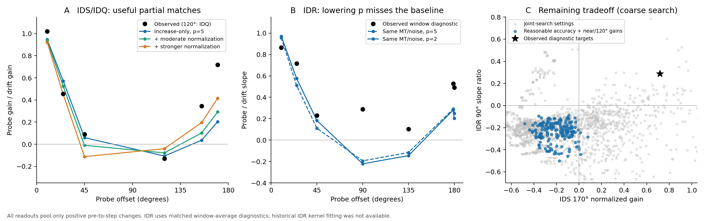

# MT readout: increase-only parameter exploration

28 October 2026 · Meetz · compact exported stimuli and behavioral summaries

The increase-only model can approach the IDS/IDQ gain profile without a negative-change pool. I did not find a shared MT/noise model that also produces the positive middle-angle IDR gains by lowering only the exponent. The clearest obstacle is the IDR response around 90°, rather than the existence of any near-null rebound.

## What was explored

7,392 screening evaluations, including overlapping grids and reference settings; 22 larger-sample finalist screens; 19 all-trial IDS/IDQ confirmations. All-trial confirmations used 23,038 trials, 128 internal-noise draws and a 2° bank. No new raw session files were needed. This is a feasibility search, not a significance test or a claim of exhaustive parameter coverage.

Every model used the full physical dot distribution, equal 500–750 and 750–1000 ms windows, independent internal noise across windows and patches, and the full 2AFC comparison. Its evidence was

`E = p-norm(max(Rstep − Rpre, 0))`.

The signed unit difference is computed before rectification. No negative-change pool, offset threshold, downstream decision noise, or angle-specific exponent was used. A single exponent applies uniformly over directions and patches; IDR can use a lower exponent. Recorded external stimulus fluctuations remain in the inputs.

The search varied mean Gaussian width (18–50°, with a separate 37.5° branch), direction-uniform three-class width mixtures, noise amplitude, angular correlation length (10–90°), global noise, smooth versus mean-balanced fields, and first-harmonic noise. Additional covariance checks used second through fourth harmonics. Width mixtures shared their directional field; their peak versus isotropic-rate scaling was also varied. Width-mixture `width_cv` is a latent spread control; `width_classes()` returns the actual widths and their actual CV.

Noise SD followed `sd × (mean response / 30)^(b/2)`. The main grid used variance exponents b = 0, 1, 1.2, 1.6 and 2. Joint diagnostics extended b to 3 and 4. Gaussian rates were floored at zero; a lognormal alternative preserved the intended mean and variance without a rate floor. The familiar b≈1.2 provides a physiological reference from the supplied Britten et al. (1993), p.1161; it is not treated as an exact bound for these shorter windows. Exponents ranged from 1.5 through 12 plus infinity; none required p=1.

## IDS/IDQ partial matches

All values below are probe gain divided by drift gain, recovered using the original predictors and bounded Weibull gain fit. The 120° target is randomized-drift IDQ. Sparse native IDS120 is retained in the machine results but excluded as a target.

| Probe offset | Observed | Increase-only, p=5 | + moderate normalization | + stronger normalization |
| --- | --- | --- | --- | --- |
| 10° | 1.02 | 0.95 | 0.94 | 0.92 |
| 25° | 0.45 | 0.57 | 0.52 | 0.45 |
| 45° | 0.09 | 0.06 | -0.01 | -0.11 |
| 120° | -0.13 | -0.11 | -0.08 | -0.04 |
| 155° | 0.35 | 0.04 | 0.10 | 0.20 |
| 170° | 0.72 | 0.20 | 0.29 | 0.42 |

The three displayed models share a nominal reference σ=25°, SD=5 response units at rate 30, b=2, and a pure first-harmonic noise field. Normalization changes the output tuning as described below. The field correlation is cos(direction separation), including −1 at 180°: a strong assumption needing biological justification. The MT mean response still uses the actual isotropic remainder and coherent dot directions. These are partial fits, not a restoration of the usual homogeneous 37.5° model.

The moderate and stronger normalization models additionally use a 140° suppressive kernel with strength 0.35 or 0.85. Their largest gains require less suppression from remote directions. The moderate case improves the rebound while leaving 45° close to zero. The stronger case reaches about 0.42 at 170° but makes 45° negative. Increasing p toward a hard max brings relatively little improvement.

Performance remains uneven:

| Offset | Observed | Increase-only | Moderate norm. | Stronger norm. |
| --- | --- | --- | --- | --- |
| 10° | 0.76 | 0.70 | 0.69 | 0.68 |
| 25° | 0.79 | 0.71 | 0.70 | 0.70 |
| 45° | 0.80 | 0.77 | 0.76 | 0.75 |
| 120° | 0.76 | 0.79 | 0.79 | 0.79 |
| 155° | 0.79 | 0.76 | 0.77 | 0.77 |
| 170° | 0.78 | 0.77 | 0.78 | 0.79 |

In particular, the near-drift conditions are underpredicted. Independent refits allowing an overall psychometric scale preserve the main gain effects; absolute gains and these refits are in `confirmed_gains.csv` and the JSON results.

A separate standardized endpoint check reassigned probe directions on the same 1,500 IDS10 trials. The baseline p=5 model gave approximately 1.00 at 0° and 0.15 at 180°; the stronger normalization p=5 model gave 1.01 and 0.36. Those are counterfactual stimulus checks, not observed IDS180 fits and not points to splice into the cross-session curve above.

## What drives the rebound

These comparisons each change one item from the hard-max, narrow-width reference:

| Comparison | 120° gain | 170° gain |
| --- | --- | --- |
| Reference: p=∞, σ=25°, pure first harmonic | -0.08 | 0.24 |
| Change p to 5 | -0.11 | 0.20 |
| Change variance exponent to 1.2 | -0.10 | 0.16 |
| Replace harmonic with smooth GP | -0.18 | -0.02 |
| Hold variance amplitude at prestep value | -0.13 | 0.13 |
| Change σ to 37.5° | -0.28 | 0.05 |

Narrower tuning and opposing noise fluctuations matter most in this comparison. Response-dependent noise amplitude contributes but is not the entire effect: freezing it at prestep values leaves a smaller positive rebound. Noise changes which units contribute positive evidence; there is no explicit decrease penalty.

Width heterogeneity can sharpen the near-drift profile while preserving a 37.5° mean, but did not solve the full profile. Changing peak versus isotropic-rate scaling across width classes did not remove the joint IDR obstacle. The oscillatory higher-harmonic covariances also failed to supply a joint solution in the tested settings.

## IDR is the stronger constraint

The historical IDR kernel-gain source was absent from the export. I therefore fitted the same window-average probit diagnostic to observed choices and simulated probabilities, conditioning on nominal step. These diagnostic ratios must not be equated with the historical kernel-weighted estimates. Observed values below use all 52,163 noisy increment trials; simulations use up to 1,500 per offset (10,293 total). The 179° yoked pair and 180° single probe were preserved; those adjacent points have different physical stimulus constructions.

| IDR offset | Observed window diagnostic | Same MT/noise, p=2 | Stronger normalization, p=2 |
| --- | --- | --- | --- |
| 10° | 0.86 | 0.97 | 0.95 |
| 25° | 0.72 | 0.58 | 0.48 |
| 45° | 0.23 | 0.18 | -0.04 |
| 90° | 0.29 | -0.22 | -0.28 |
| 135° | 0.10 | -0.15 | 0.12 |
| 179° | 0.53 | 0.28 | 0.84 |
| 180° | 0.49 | 0.20 | 0.99 |

For the unnormalized candidate, decreasing p from 5 to 2 changes 90° from about −0.19 to −0.22, and 135° from −0.12 to −0.15. This goes in the wrong direction for the positive IDR baseline. Stronger broad normalization creates a large near-null rise and some gain at 135°, but still misses 90° and can overshoot the 180° gain.

The joint search included IDR conditions from the outset and extended to stronger noise scaling and strong local normalization. None of 2,080 joint screening settings passed a loose descriptive combination of reasonable performance, near-drift/120°/45° IDS gains, positive 170° gain, and positive middle-angle IDR gains. This finite screen is evidence about these implemented families, not an impossibility result.

## IDJ catches an additional tradeoff

The MT/noise parameters were transferred without a new noise fit. Actual allocations, external noise and dot budgets were preserved:

| Largest allocation fraction | Observed accuracy | Reference p=5 | Stronger variance scaling |
| --- | --- | --- | --- |
| 1.00 | 0.76 | 0.71 | 0.73 |
| 0.70 | 0.74 | 0.69 | 0.74 |
| 0.50 | 0.70 | 0.67 | 0.74 |
| 0.33 | 0.71 | 0.68 | 0.76 |

The reference has a modest allocation cost. A stronger-noise-scaling candidate (σ=18°, b=3, SD=7.5, p=5) raises the full-data IDS170 gain to about 0.49, but its IDQ120 gain becomes positive (~0.16), and IDJ performance improves with divided allocation. That reverses the observed allocation cost. Extra variance nonlinearity does not provide a clean rescue.

## Directional normalization: useful but constrained

This was one explicit mean-response normalization family, using a Gaussian-weighted sum of the actual dot distribution in the denominator. It operates on physical directions, so coincident streams are equivalent to one combined stream. Noise is added at the normalized MT output, not inside a simulated recurrent normalizer.

For each strength, the excitatory kernel and response gain were calibrated to preserve the isotropic baseline and preferred response at 15% coherence. Other responses were checked rather than assumed to remain linear. For the displayed moderate and stronger models, the maximum single-direction deviations from the unnormalized preferred coherence curve are approximately 7.6% and 16.3% of its full 0–100% response excursion; corresponding null deviations are 4.2% and 11.7%. Up to 30% coherence the largest absolute differences are about 0.90 and 2.14 response units. These are calibration costs to evaluate biologically, not numerical fit tolerances inferred from Britten et al.

## Numerical and scope checks

Rotation invariance, coincident-stream invariance, agreement with the original homogeneous implementation, noise moments, and patch/window independence passed. With exactly matched first-harmonic noise, switching 2° to 1° changes individual trial probability by at most 0.000732 in the tested finalists. Independent 512-draw runs change mean probability by at most 0.000327 on the matched 2,100-trial check set, with per-trial RMS differences of 0.034–0.038 relative to 64 draws. Small-subset fitted gains can consequently shift by around 0.1. Two main p=5 candidates were additionally repeated on all 23,038 trials with an independent seed and 256 draws. The largest change in normalized gain across the six target conditions was 0.024. Full replication results are retained in independent_full_data.json. These checks support numerical stability; they do not validate a biological mechanism or guarantee that the parameter search found every solution.

Unexplored mechanisms include independent noise among additional cell subtypes, more realistic stimulus-dependent covariance, recurrent normalization with noise inside its denominator, and richer prestep adaptation. All present results use the specified window-average representation.

## Recommendation

Keep the positive-change readout as a serious candidate: it can supply a substantial near-null rebound without explicitly pooling decreases. Retain the moderate-normalization p=5 model as a concrete reference, with the stronger case illustrating the tradeoff. Further broad tuning of the same noise parameters now has lower value. The next mechanism should first explain how oblique probes create positive IDR evidence while preserving single-direction coherence calibration, IDS120, and the sign of the IDJ allocation cost. Prestep-dependent gain control or recurrent competition could be tested for that specific job. This round does not establish that either will work.

The code, all screening records, finalist predictions, absolute gains, endpoint checks, task transfers, and numerical checks accompany this report. The compact input ZIP is not duplicated.
